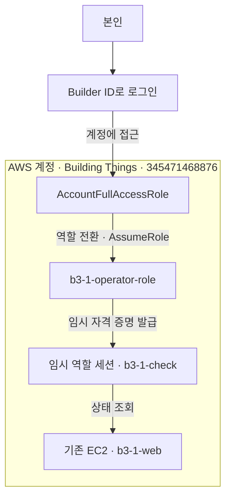
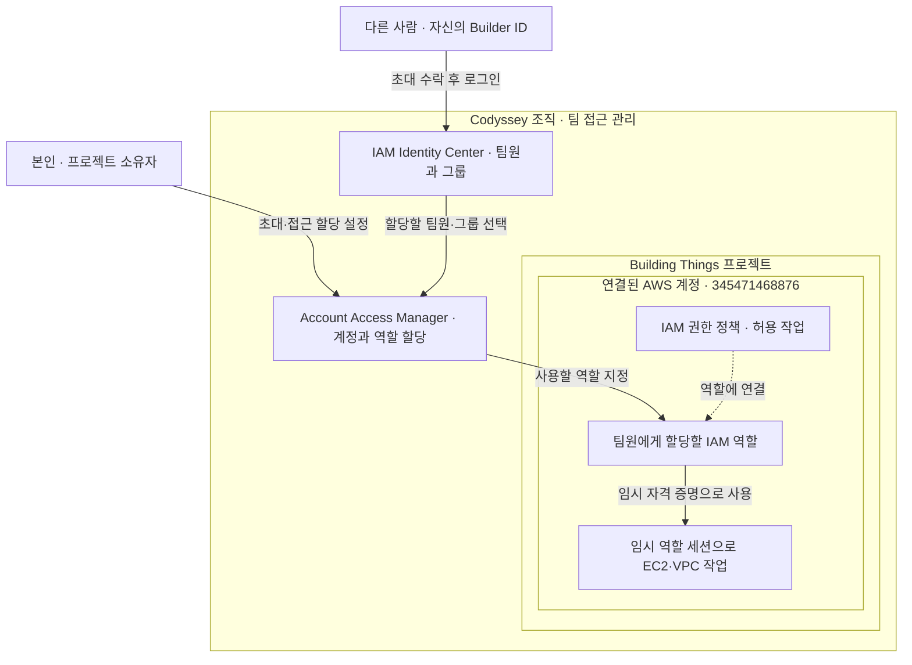

# B3-1에서 헷갈렸던 로그인 ID, AWS 계정, IAM 사용자와 역할

작성일 **2026-11-18 KST**. B3-1의 IAM 최소권한 실습에서 생긴 질문을 용어, 접근 구조, 실제 실행 결과에 연결한 학습 기록이다.

**Builder ID로 로그인하고, Building Things라는 AWS 계정에 접근해, 그 계정 안의 IAM 역할로 작업했다.** 이 문장을 기준으로 각 용어를 읽으면 된다.

## 1. 미션에서 요구한 것은 무엇인가

B3-1 Mission Core에는 다음과 같이 적혀 있다.

> AdministratorAccess 없이 실습에 필요한 범위로 제한한 IAM 사용자/Role을 사용한다.

여기서 `/`는 IAM 사용자 또는 IAM 역할 중 적절한 방식을 선택한다는 뜻이다. 이번 실습에서는 별도 역할 `b3-1-operator-role`로 전환해 제한된 권한을 사용했다. 허용 범위와 실제 실행 결과는 [IAM 검증 기록](peer-evaluation-guide.md#iam-validation-2026-11-16)에서 확인한다.

요구사항 원문은 [B3-1 미션 페이지](https://app.notion.com/p/3d462d4e038081a2818effeb4940d668)에 있다.

## 2. 같은 ‘계정’처럼 들리던 용어를 나누기

일상에서 ‘계정’은 로그인 ID를 떠올리게 한다. AWS에서는 사람의 로그인 신원과 리소스가 속한 AWS 계정을 각각 구분한다.

| 용어 | 의미와 목적 | B3-1에 대입하기 |
|---|---|---|
| AWS Builder ID | 개인을 나타내는 로그인 신원. AWS의 새 가입·접근 방식에서는 이 ID로 프로젝트와 AWS 설정에 접근한다. | 본인의 이메일에 연결된 Builder ID로 로그인했다. |
| AWS 계정 | EC2·VPC 같은 리소스가 속하고, 사용 비용과 권한의 경계를 이루는 단위. 12자리 계정 ID로 구분한다. | Building Things, 계정 ID `345471468876`. |
| IAM 사용자 | 특정 AWS 계정 안에 만드는 신원. 이름을 정하고 용도에 따라 자격 증명과 권한을 설정한다. 사람이나 프로그램이 사용할 수 있다. | 이번 접근 방식에서는 별도의 IAM 사용자를 만들지 않았다. |
| IAM 역할 | AWS 계정 안에 만드는 신원. 누가 맡을 수 있는지와 맡은 뒤 어떤 작업을 할 수 있는지를 정책으로 정한다. | `AccountFullAccessRole`, `b3-1-operator-role`. |
| 권한 정책 | 허용하거나 거부할 AWS 작업, 리소스, 조건을 적은 규칙. 사용자나 역할에 연결할 수 있다. | 기존 역할에는 `AdministratorAccess`, 새 역할에는 `B31SeoulNetworkInspection`을 사용했다. |
| 역할 세션 | 역할을 맡아 임시 자격 증명으로 작업하는 동안의 신원. | `b3-1-operator-role/b3-1-check` 세션으로 EC2를 조회했다. |
| IAM Identity Center의 사용자·팀원 | 조직에 접근하는 사람을 관리하는 항목. 이 환경에서는 초대한 사람의 Builder ID를 로그인 신원으로 사용한다. | 고급 기능을 활성화한 환경의 팀원 초대·접근 관리에서 확인한다. |

‘IAM 계정을 만든다’고 말할 때는 **AWS 계정 생성**, **IAM 사용자 생성**, **IAM 역할 생성** 중 어느 작업인지 구체적으로 표현하면 콘솔 메뉴와 연결하기 쉽다.

Builder ID로 AWS 콘솔에 접근하는 설명은 이 실습에서 사용한 새 가입·접근 방식에 해당한다. AWS 공식 문서도 일반 Builder ID 사용과 새 AWS 환경에서의 사용을 나누어 설명한다. [AWS Builder ID와 다른 자격 증명의 관계](https://docs.aws.amazon.com/signin/latest/userguide/differences-builder-id.html)

## 3. ‘ID 안에 계정을 만들고, 그 안에 사용자를 만든다’는 이해

소유·접근 관계는 **Builder ID로 AWS 계정을 만들고 접근한다**고 표현한다. 그 AWS 계정 안에는 필요에 따라 IAM 사용자와 역할을 만든다. 이 환경에서는 Builder ID가 프로젝트 계정을 소유하며, 고급 기능을 활성화한 뒤에도 그 소유 관계가 이어진다. [고급 기능 활성화 후 프로젝트 계정](https://docs.aws.amazon.com/accounts/latest/reference/activate-advanced-features.html)

이번 실습의 접근 흐름은 다음과 같다. 상자 안의 역할과 EC2는 모두 같은 Building Things 계정에 속한다.

AWS 계정 선택은 **어느 계정의 리소스를 다룰지** 고르는 일이다. 역할 전환은 **어떤 신원과 권한으로 작업할지** 고르는 일이다. 이번에는 Building Things 계정 안에서 역할을 전환했다.

## 4. AWS를 사용하는 내가 IAM ‘사용자’ 목록에는 없는 이유

IAM 콘솔의 **사용자** 목록에는 현재 AWS 계정 안에 따로 만든 IAM 사용자들이 표시된다. 본인은 Builder ID로 로그인해 역할 세션을 사용했으므로, IAM 사용자 목록에 별도 항목이 생기는 절차를 거치지 않았다.

| 확인하고 싶은 것 | 확인하는 곳 |
|---|---|
| 개인 로그인 프로필 | AWS Builder ID 프로필 |
| 접근 가능한 프로젝트·계정 | AWS Settings의 프로젝트 목록 |
| 초대한 팀원과 그룹 | IAM Identity Center → 사용자·그룹 |
| 팀원·그룹에게 할당한 계정과 역할 | AWS Account Access Manager |
| 해당 계정에 만든 IAM 사용자 | IAM → 사용자 |
| 해당 계정에 만든 역할과 정책 | IAM → 역할 → 역할 선택 → 권한·신뢰 관계 |
| 지금 CLI가 실제로 쓰는 신원 | `aws sts get-caller-identity` 결과의 `Account`, `Arn` |

AWS의 새 환경에서는 프로젝트에 사람을 추가할 때 팀 초대를 사용하며, IAM 사용자의 콘솔 로그인 생성에는 제약이 있다. 사용자를 만드는 절차와 그 사용자로 콘솔에 로그인하는 절차는 각각 지원 여부를 확인해야 한다. [IAM 사용자 공식 문서](https://docs.aws.amazon.com/IAM/latest/UserGuide/id_users.html)

### 4.1. 다른 사람의 Builder ID를 내 프로젝트에 연결하는가

**다른 사람에게 내 프로젝트 접근 권한을 주려면, 그 사람의 이메일로 팀원 초대를 보내고 대상 AWS 계정과 역할을 지정한다.** 초대받은 사람은 자신의 Builder ID로 로그인한다. 프로젝트에는 AWS 계정과 협업 설정이 포함되고, 그 계정에 EC2·VPC 같은 리소스가 속한다.

여기서 사람을 관리하는 항목은 **IAM Identity Center의 사용자·팀원**이다. IAM 콘솔의 **사용자**는 해당 AWS 계정 안에서 별도로 만드는 신원이다. 두 화면에서 ‘사용자’라는 같은 말을 보더라도 무엇을 등록하는지 확인한다.

| 사람에게 접근을 주는 방식 | 관리하는 곳 | 로그인과 권한의 연결 |
|---|---|---|
| Builder ID 기반 팀원 초대 | IAM Identity Center의 사용자·그룹, AWS Account Access Manager | 본인의 Builder ID로 로그인하고, 할당받은 계정의 역할로 작업한다. |
| IAM 사용자 생성 | 대상 AWS 계정의 IAM → 사용자 | 계정 안에 만든 신원에 자격 증명과 정책을 설정한다. 역할 사용을 허용할 수도 있다. |

AWS Account Access Manager는 IAM의 기능이며, IAM Identity Center의 사용자·그룹에게 AWS 계정의 기존 IAM 역할을 할당한다. [계정 접근 할당](https://docs.aws.amazon.com/IAM/latest/UserGuide/aam-manage-access-to-aws-accounts.html), [IAM 사용자](https://docs.aws.amazon.com/IAM/latest/UserGuide/id_users.html)

### 4.2. 팀원 초대부터 서비스 작업까지의 관계도

아래 그림은 다른 사람에게 역할을 할당하는 구성을 설명한다. 이번 실습에서 직접 검증한 접근은 3절의 관리자 역할에서 제한 역할로 전환하는 흐름이다. 팀원 초대·할당은 설명용 구성이다.

**초대**는 우리 조직에 접근할 사람을 추가하는 일이다. **할당**은 그 사람이 어느 계정에서 어떤 역할을 쓸지 정하는 일이다. **역할의 권한 정책**은 그 세션으로 어떤 AWS 작업을 허용할지 정한다. 한 팀원이 여러 계정에 접근하거나, 여러 팀원이 같은 역할을 사용하도록 구성할 수도 있다. [팀원 관리](https://docs.aws.amazon.com/accounts/latest/reference/manage-workforce-members.html), [계정 접근 할당](https://docs.aws.amazon.com/IAM/latest/UserGuide/aam-manage-access-to-aws-accounts.html)

### 4.3. 현재 고급 기능 환경에서 관리하는 위치

사용자가 공유한 AWS Settings에는 **고급 기능 활성화 완료**와 `Codyssey Identity Delegated Admin` 계정이 표시되어 있었다. Builder ID를 로그인 신원으로 계속 사용하는 환경의 공식 절차는 다음과 같다.

1. AWS Settings → 프로젝트 → `Codyssey Identity Delegated Admin`의 AWS Console을 연다.
2. IAM Identity Center → 사용자 → **Invite new team member**에서 이메일로 초대한다. 위임 관리자 역할은 미국 동부 버지니아 북부 리전에서 사용한다.
3. 상대가 수락하면 대상 AWS 계정의 접근 권한을 설정한다. 특정 역할을 통한 사용자 지정 접근은 **AWS Account Access Manager**에서 할당한다.

고급 기능 활성화 전의 간편 팀 초대는 프로젝트 관리자 권한을 제공한다. 현재 고급 기능 환경에서는 팀원 추가와 역할별 접근 할당을 함께 살펴야 한다. AWS Settings에서 사용자 지정 역할을 제공하려면 역할의 세션 길이를 12시간으로 설정하라는 공식 조건도 확인한다. [고급 기능 이후 팀원 관리](https://docs.aws.amazon.com/accounts/latest/reference/manage-workforce-members.html), [고급 기능 활성화](https://docs.aws.amazon.com/accounts/latest/reference/activate-advanced-features.html), [간편 환경 팀 초대](https://docs.aws.amazon.com/accounts/latest/reference/invite-team-members.html)

현재 `b3-1-operator-role`의 신뢰 정책에는 기존 `managed/AccountFullAccessRole`을 지정했다. 검증한 접근 경로는 그 역할에서의 `AssumeRole`이다. 다른 팀원에게 이 역할을 제공하려면 별도의 역할 할당과 신뢰 관계 등 접근 설정을 검토하고, 실제 팀원 세션에서 신원과 허용 작업을 확인한다. 현재 실습의 확인 범위는 [2026-11-16 IAM 검증 기록](peer-evaluation-guide.md#iam-validation-2026-11-16)을 따른다.

## 5. IAM 사용자는 ‘역할을 사용하는 사람’인가

IAM 사용자는 AWS 계정 안에 만든 **독립적인 신원**이다. 사용자에게 정책을 연결하면 그 권한으로 AWS 작업을 할 수 있다. 역할 전환이 허용되어 있으면 역할을 맡아 임시 세션으로 작업할 수도 있다.

역할은 IAM 사용자, 다른 역할의 세션, 외부 로그인 신원, AWS 서비스 등에게 맡기도록 구성할 수 있다. 그래서 역할을 사용하는 사람이 먼저 IAM 사용자로 만들어져 있어야 한다는 순서를 전제할 필요가 없다. 이번에는 기존 관리자 역할의 세션에서 새 역할을 맡았다.

역할을 이해할 때는 두 질문을 확인한다.

| 질문 | 확인할 정책 |
|---|---|
| 누가 이 역할을 맡을 수 있는가? | **신뢰 정책**. 실제 역할 전환에는 호출 측 권한과 관련 제한도 함께 적용된다. |
| 이 역할로 무슨 작업을 할 수 있는가? | **권한 정책**. 최종 허용 여부에는 SCP 같은 상위 제한도 적용된다. |

`AccountFullAccessRole`에서 전환했어도 새 세션은 `b3-1-operator-role`의 권한과 적용 제한으로 평가된다. [IAM 역할](https://docs.aws.amazon.com/IAM/latest/UserGuide/id_roles.html), [AssumeRole API](https://docs.aws.amazon.com/STS/latest/APIReference/API_AssumeRole.html)

## 6. 실제로 확인한 결과를 용어에 연결하기

2026-11-16 사용자가 공유한 CloudShell 결과를 기준으로 한다.

| 확인한 사실 | 의미 |
|---|---|
| `Account`가 `345471468876` | 작업 대상 AWS 계정은 Building Things였다. |
| ARN에 `assumed-role/b3-1-operator-role/b3-1-check` 표시 | 새 역할을 맡은 임시 세션으로 작업하고 있었다. |
| `DescribeInstances`가 기존 EC2의 `running` 상태 반환 | 그 세션에서 EC2 조회가 허용됐다. |
| `StopInstances --dry-run`이 `UnauthorizedOperation` 반환 | 그 세션에서 중지 권한이 거부됐다. `--dry-run`은 권한을 점검하는 요청이다. |

실행 결과와 정책 범위의 원본 기록은 [2026-11-16 IAM 검증](peer-evaluation-guide.md#iam-validation-2026-11-16)에 있다. 이 문서는 그 결과를 설명하는 학습 기록이며, 확인 시점은 해당 기록을 따른다.

`root`, 관리자 역할, 제한 역할도 각각 구분해서 읽는다. **루트 사용자**는 특정 AWS 계정의 특별한 신원이고, **관리자 역할**은 넓은 작업 권한을 가진 IAM 역할이다. 이번 검증에서 출발한 신원은 `AccountFullAccessRole`의 세션이었다. 새 역할의 목적은 기존 환경을 제한된 권한으로 점검하는 것이었다. [AWS 루트 사용자](https://docs.aws.amazon.com/IAM/latest/UserGuide/id_root-user.html)

## 7. 동료에게 설명하는 문장

> Builder ID로 로그인해 Building Things라는 AWS 계정에 접근했습니다. 그 계정 안에 최소권한 IAM 역할을 만들고, 기존 관리자 역할에서 새 역할로 전환했습니다. 같은 AWS 계정에서 작업 권한이 바뀐 것입니다. IAM 사용자는 별도로 만들지 않았고, 새 역할의 임시 세션에서 EC2 조회 성공과 중지 권한 거부를 확인했습니다.

