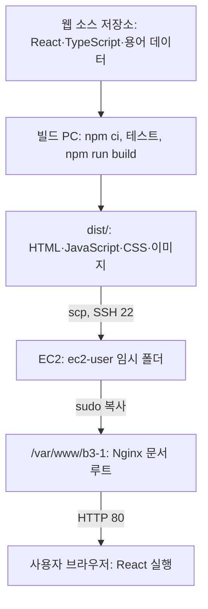
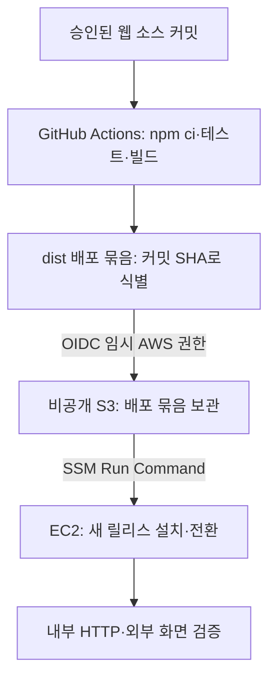

# B3-1 · 용어사전 AWS 재배포와 자동화 설계

> 상태: 현재 배포 방식의 설명과 **향후 자동화 제안**. 이 문서 작성만으로 GitHub Actions, IAM, S3, Systems Manager 또는 EC2 설정은 바뀌지 않는다. 공식 미션 표기는 B3-1이다.

## 1. 두 저장소와 현재 배포 상태

| 구분 | 저장소/위치 | 역할 |
|---|---|---|
| 웹 소스 | [`codyssey-mission-tech-glossary`](https://github.com/hyun02063185-AX-beginner/codyssey-mission-tech-glossary) | React·TypeScript·CSS·용어 원본과 `npm run build` |
| 평가·운영 기록 | 이 `Codyssey_B3-1` 저장소 | AWS 구성, Nginx 설정, 배포·검증 증빙 |
| GitHub Pages | 웹 소스 저장소의 `.github/workflows/deploy-pages.yml` | `main` 푸시 시 별도 빌드·배포 |
| AWS EC2 | Building Things 계정, 서울 리전 | `/var/www/b3-1`의 정적 파일을 Nginx가 HTTP로 제공 |

2026-10-14 [최초 배포 기록](deployment-log-2026-10-14.md)의 AWS 빌드 기준선은 `5ada699c1c462d957295c3e5d1b44567a9cc565b`다. 이후 웹 소스 저장소에 커밋이 생겨도 **AWS 서버에 새 파일을 전송했다는 증빙은 이 기록에 없다**. 실제 서비스 버전은 재배포할 때마다 새 커밋 SHA와 검증 시각을 기록해야 한다. GitHub Pages 배포와 AWS 배포는 서로 영향을 주지 않는다.

### 현재의 빌드·전송·제공

`npm run build`는 용어 데이터를 브라우저용으로 생성하고 TypeScript 검사와 Vite 빌드를 수행한다. EC2에서 Node나 Vite 개발 서버를 상시 실행하지 않는다. 브라우저의 `/#/terms` 같은 `#` 뒤 경로는 React `HashRouter`가 처리한다. Nginx는 먼저 `index.html`과 정적 자산을 보낸다.

현재 작업 절차는 [README의 실행 순서](../README.md#실행-순서)를 따른다. 새 버전을 배포하려면 **대상 커밋을 확정**하고, 웹 소스 저장소에서 빌드·테스트해 새 `dist/`를 전송한 뒤 서버 문서 루트에 배치한다. `nginx -t`, 서버 내부 `curl -I http://localhost`, 외부 브라우저의 용어 페이지 확인을 기록한다. 웹 파일만 교체하면 Nginx 설정을 매번 다시 설치하거나 프로세스를 재시작할 필요는 없다. 현재 방법은 파일을 덮어쓰므로 이전 파일 정리와 되돌리기 절차를 자동화 설계에서 개선한다.

## 2. 자동화가 해결할 일과 배포 트리거

자동화는 사람이 하던 **빌드 → 파일 전달 → 서버 배치 → 검증 → 실패 시 되돌리기**를 재현하는 것이다. 콘텐츠의 정확성과 화면 완성도를 자동으로 승인하는 기능은 아니다.

| 트리거 | 동작 | B3-1에서의 판단 |
|---|---|---|
| 웹 소스 `main` 푸시 | 모든 커밋을 즉시 AWS에 배포 | 품질 확인 전 변경까지 평가용 AWS 화면에 반영될 수 있어 지금은 사용하지 않음 |
| GitHub Actions의 수동 실행(`workflow_dispatch`) | 리뷰가 끝난 커밋을 지정해 배포 단계만 자동 실행 | **우선 권장**. 버튼은 사람이 누르지만 배포 수행과 검증은 자동화 |
| 승인된 릴리스 태그 | 태그가 붙은 커밋만 AWS에 배포 | 운영 규칙이 정착한 뒤 선택 가능 |

배포 워크플로는 **웹 소스 저장소**에 둔다. 이 평가 저장소에는 설계와 실행 증빙을 남긴다. 최초 구현 전에는 동료 평가용 AWS 버전을 새 콘텐츠로 갱신할지 정하고, 검증할 화면과 커밋을 확정한다.

## 3. 권장 설계: GitHub Actions → AWS → EC2

1. 웹 소스 저장소의 `workflow_dispatch`에서 대상 커밋을 고정한다. 임의의 PR 코드나 검증하지 않은 커밋을 운영 권한으로 실행하지 않는다.
2. GitHub 실행기에서 `npm ci`, 테스트, `npm run build`를 수행한다. **빌드는 EC2 t3.micro가 아니라 실행기에서** 한다. `dist/`만 묶어 커밋 SHA로 식별한다.
3. GitHub Actions의 OIDC로 Building Things 계정의 **한정된 IAM 역할**을 임시로 맡는다. GitHub 저장소에 장기 AWS Access key나 EC2 SSH 개인키를 보관하지 않는다. 역할의 신뢰 조건을 해당 저장소·배포 환경·허용 브랜치로 제한하고 실제 OIDC subject 형식은 구현 시 계정 설정과 공식 문서에 맞춰 검증한다.
4. 실행기는 배포 묶음을 비공개 S3 버킷의 전용 prefix에 올린다. 퍼블릭 읽기를 막고 보관 기간을 정한다.
5. Systems Manager Run Command가 **지정된 EC2 한 대**에 설치 명령을 전달한다. EC2의 SSM Agent와 인스턴스 역할이 명령을 수신하고 해당 S3 객체만 읽어 새 릴리스 디렉터리에 압축을 푼다. EC2 안에서 GitHub 로그인이나 npm 빌드를 하지 않는다.
6. 새 파일과 `index.html`의 존재를 확인하고 현재 제공 경로를 새 릴리스로 전환한다. 배포 전 경로를 남겨 둔다. Nginx 문서 루트가 현재 `/var/www/b3-1`이므로, **릴리스 디렉터리와 `current` 심볼릭 링크를 쓰려면 Nginx root 변경·`nginx -t`·reload가 한 번 필요하다.** 이 이행은 기존 파일을 보존하면서 별도 작업으로 수행한다.
7. `nginx -t`, EC2 내부 HTTP 200, 외부 `http://<현재 Public IP>/#/terms`의 화면 및 필요한 정적 자산을 확인한다. 해시 경로의 `#`은 서버 요청에 포함되지 않으므로 `curl` 200만으로 React 화면 성공을 증명하지 않는다. 실패하면 이전 릴리스로 되돌리고 실패 로그와 실행 SHA를 기록한다.
8. 성공한 커밋·실행 URL·배포 시각·내외부 검증 결과·실패/복구 여부를 이 저장소의 배포 기록에 덧붙인다. Public IP가 바뀌었다면 평가용 URL도 갱신한다.

### 최초 설정 전에 확인할 것

- **현재 EC2에는 IAM instance profile이 없다.** SSM 관리 대상 등록에 필요한 역할·권한과 SSM Agent 상태를 확인하고, EC2에 역할을 연결해야 한다. 역할에는 SSM의 관리 기능과 배포 객체의 읽기 권한만 준다. 계정 전체에 자동 관리 권한을 켜는 선택지는 B3-1 한 대의 최소권한 목표와 비교해 결정한다.
- GitHub 배포 역할에는 전용 S3 prefix 쓰기, 지정 인스턴스에 대한 SSM 명령 실행과 실행 결과 조회 등 필요한 작업만 허용한다. IAM 정책의 리소스별 제약 가능 여부와 `iam:PassRole`이 필요한 설정 단계는 구현 시 검증한다.
- S3 비공개 버킷·보관 규칙과 새 릴리스 저장 공간을 설계한다. IAM 역할, SSM Agent, VPC에서 SSM/S3로 나가는 연결을 실제로 확인한다. 현재 Public Subnet과 아웃바운드 경로를 활용하며 NAT Gateway를 새로 만들지 않는다.
- 기존 SG의 SSH 22는 현재 관리자 IP `/32` 제한을 유지한다. GitHub 실행기를 위해 22를 `0.0.0.0/0`으로 넓히지 않는다. GitHub 호스팅 실행기의 광범위하고 변하는 IP를 허용 목록으로 쓰지 않는다.
- SSH 키·AWS Access key·S3 객체의 공개 URL을 Git에 넣지 않는다. GitHub Pages 워크플로는 그대로 두며 AWS 워크플로는 별도로 만든다.
- 비용: 기존 EC2·Public IPv4·EBS 비용은 계속 발생한다. SSM Run Command는 EC2 노드에서 추가 요금이 없지만 S3 저장·요청, GitHub Actions 사용량, 선택한 로그·전송 항목은 별도로 확인한다. 버킷과 릴리스는 [정리 체크리스트](cleanup-checklist.md)에 추가한다.

## 4. 구현·검증 순서와 완료 조건

1. **설계 승인:** 배포 트리거, 검토할 화면, 릴리스 보관 기간, 새 AWS 리소스와 예상 비용을 확정한다.
2. **AWS 준비:** 전용 S3, OIDC 신뢰와 최소권한 역할, EC2 SSM 연결을 구성한다. 배포 전 현재 Nginx 파일을 보존한다.
3. **서버 이행:** 새 릴리스 디렉터리와 전환·롤백 스크립트를 준비하고 Nginx 문서 루트를 한 번 변경한다. 기존 화면이 계속 열리는지 확인한다.
4. **워크플로 구현:** 웹 소스 저장소에 수동 실행 워크플로를 추가한다. 기존 Pages 배포 워크플로에는 AWS 권한을 섞지 않는다.
5. **시범 배포:** 승인된 특정 SHA를 실행해 빌드 결과와 AWS 결과가 같은 버전인지 확인한다. 고의로 실패하는 시나리오에서 이전 버전으로 복귀하는지도 검증한다.
6. **운영 기록:** 실제 적용된 IAM 범위, 배포 실행 링크, 비용·리소스, 검증 결과, 정리 절차를 문서에 기록한다. 그때서야 상태를 ‘자동 배포 설정 완료’로 바꾼다.

## 공식 문서

- [GitHub Actions 수동 실행](https://docs.github.com/en/actions/how-tos/manage-workflow-runs/manually-run-a-workflow)
- [GitHub Actions의 AWS OIDC](https://docs.github.com/en/actions/how-tos/secure-your-work/security-harden-deployments/oidc-in-aws)
- [GitHub 호스팅 실행기의 IP](https://docs.github.com/en/actions/reference/runners/github-hosted-runners)
- [EC2의 Systems Manager 권한](https://docs.aws.amazon.com/systems-manager/latest/userguide/setup-instance-permissions.html)
- [AWS Systems Manager Run Command](https://docs.aws.amazon.com/systems-manager/latest/userguide/run-command.html)
